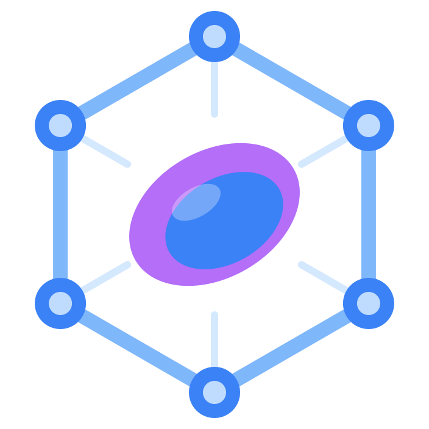
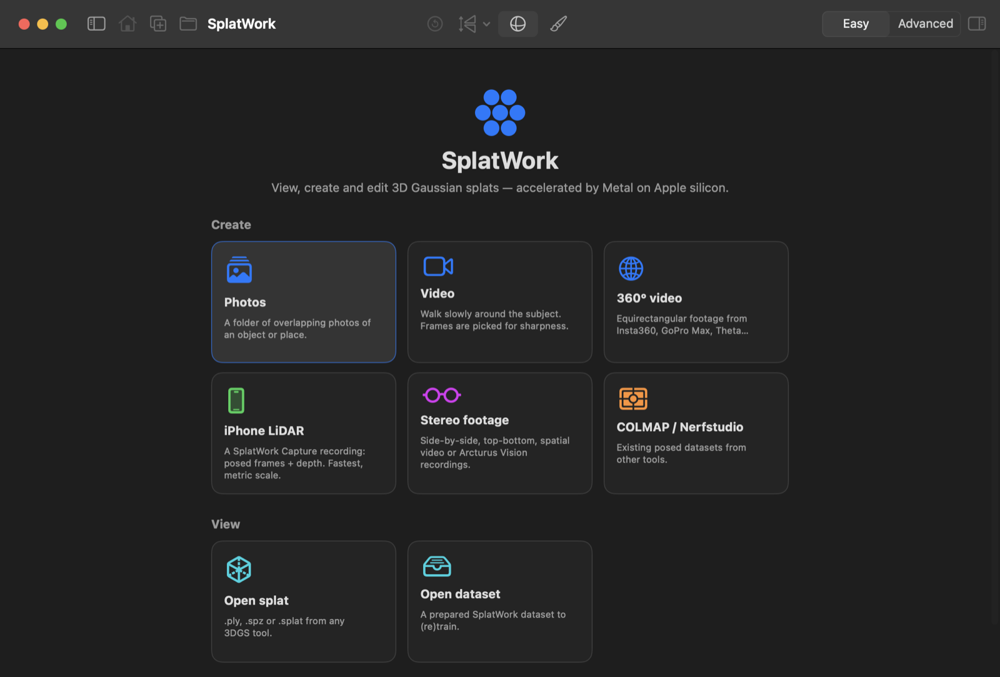

<p align="center"></p>

# SplatWork

**Make, train, view and edit 3D Gaussian splats on your own machines.** Capture on an iPhone, prepare and view on a
Mac, and train on whichever of your machines are free: your Mac's GPU, other Macs, and Linux PCs with NVIDIA cards.
Big scenes are split into blocks that train on several devices at once and are merged back into one splat.

Everything runs locally on your network. No cloud account, no uploads to anyone else.

[**Website**](https://benevision.github.io/SplatWork/) · [Download](#download) · [Quick start](#quick-start) · [User guide](docs/USER_GUIDE.md) ·
[Documentation](docs/README.md) · [Changelog](CHANGELOG.md) · [Contributing](CONTRIBUTING.md)

<p align="center">
  
</p>

## The apps

| App | Runs on | What it does |
|---|---|---|
| **SplatWork** | Mac (Apple silicon, macOS 15+) | The main app. Turns photos, video, 360° video, stereo footage, iPhone captures and COLMAP / Nerfstudio datasets into splats. Native Metal renderer and trainer, editor, exporter, and the coordinator for every other device. |
| **SplatWork for Linux** | Linux PC with an NVIDIA GPU (Flatpak) | A CUDA worker (gsplat) that the Mac and iPhone send training and processing jobs to, and a full desktop studio of its own: viewer, new projects, editing and export on Linux. |
| **SplatWork Capture** | iPhone (iOS 18+; LiDAR models record depth) | Records ARKit-posed frames with LiDAR depth and sends them to the Mac. Can also turn its own scans into splats on the phone, or hand the heavy steps to your Mac or PC. |
| **splatprep** | Mac or Linux (Python) | The processing toolkit inside the apps: learned feature matching and camera solving (COLMAP / GLOMAP), moving-object and sky masks (SAM 2), video splitting and benchmarks. Also usable on its own from the command line. |

## Highlights

- **Any source.** Photos (blurry and duplicate shots rejected), video (sharpest frames picked), 360° video and photos
  (cut into flat views), stereo footage (side-by-side, top/bottom, two files, Apple spatial video; metric scale from
  the baseline), iPhone LiDAR captures, COLMAP and Nerfstudio datasets.
- **Camera solving that fits the footage.** Apple Object Capture built in, or COLMAP / GLOMAP with SIFT,
  SuperPoint, DISK or ALIKED + LightGlue, LoFTR and more. iPhone poses are refined rather than re-solved, drone photos
  are checked against their GPS, and cameras placed far off the camera path are dropped.
- **People, cars and sky handled.** Masks for people and pets (Apple Vision), open-vocabulary moving objects with
  SAM 2 tracking, a mask editor with click-to-select, and a learned skybox so distant sky doesn't turn into haze.
- **A real trainer on the Mac.** A differentiable Metal rasterizer with analytic gradients, 3DGS-MCMC and adaptive
  densification, anti-aliasing, depth and surface-normal supervision, per-photo colour correction and held-out
  evaluation. On Linux the same settings drive [gsplat](https://github.com/nerfstudio-project/gsplat).
- **Your devices work as one.** Pick the devices for each project; each stage runs where it is fastest, and large
  scenes train as blocks on all of them. Pause, resume, retry a failed block on another device, and keep watching
  the live preview from anywhere.
- **Nothing is lost when something stops.** Each processing stage is checkpointed, training saves checkpoints and
  every finished block, and worker jobs carry on while the Mac sleeps. The Projects list shows where each project
  stands and resumes it from any stage.
- **View, clean up and export.** Fast Metal viewer with orbit and fly navigation and depth, ellipse, opacity and
  coverage modes. Auto clean removes splats no photo needs. Crop, brush selection and undo. Export PLY, SPZ or
  `.splat`, 4K screenshots and turntable videos.
- **Easy or Advanced.** Easy shows presets and the few choices that matter; Advanced shows every parameter. Every
  setting has a built-in explanation, collected in the [settings reference](docs/SETTINGS.md).

## Download

Ready-built apps are on the [**Releases page**](https://github.com/Benevision/SplatWork/releases).

**SplatWork for Mac** (Apple silicon, macOS 15 or later): download the `.dmg` and drag SplatWork to Applications.
The app isn't notarized yet, so the first time, right-click it and choose **Open**. It updates itself from new
releases (SplatWork → Check for Updates…). A rolling *developer build* with the latest changes is published as a
pre-release.

**SplatWork for Linux for Linux** (NVIDIA GPU, any distribution with Flatpak): install it from the project's Flatpak
repository, so updates arrive through `flatpak update`, GNOME Software or KDE Discover:

```bash
flatpak install --user https://benevision.github.io/SplatWork/flatpak/splatworker.flatpakref
```

Open **SplatWork for Linux**; its setup assistant detects your driver and installs a matching PyTorch and gsplat
(about 2.7 GB, all inside the app's own folder). Then turn the server on. Details:
[linux/README.md](linux/README.md).

**SplatWork Capture for iPhone** isn't on the App Store yet. Build it from source with Xcode: see
[ios/README.md](ios/README.md).

## Quick start

1. Open SplatWork on the Mac and choose **New** (⌘N), or drop a folder of photos, a video or a capture onto the
   window.
2. Pick a quality preset. *Quick preview* takes a few minutes and is the best way to check that the cameras solved
   well before a long run.
3. Choose where processing and training run: this Mac, a Linux worker, or several devices at once.
4. Watch it train live. When it finishes, the result opens in the viewer; clean it up in **Edit** and save it with
   **Export** (⌘E).

The [user guide](docs/USER_GUIDE.md) covers capture tips, every step and troubleshooting.

**Optional extras:**
- **A Linux PC with an NVIDIA GPU** running SplatWork for Linux trains several times faster than a laptop and runs the
  learned camera solvers and masks. The Mac finds it automatically on the local network.
- **The Models pack** (Mac, from *Models & Benchmarks*) adds learned feature matchers and segmentation models to the
  Mac itself.
- **SplatWork Capture** on a LiDAR iPhone gives posed frames and depth, so no camera solving is needed and the scene
  is in metres.

## How it works

```
 iPhone                         Mac                                        Linux PC (NVIDIA)
 SplatWork Capture              SplatWork                                  SplatWork for Linux
 ─────────────────              ─────────                                  ──────────────
 ARKit frames + LiDAR ─send──▶  source ─▶ frames ─▶ masks ─▶ cameras ─▶ dataset
                                  │          └───────┴───────┴─ on the worker if chosen ──▶ splatprep (CUDA)
                                  ▼
                                training: this Mac (Metal) │ a worker (gsplat) │ blocks on all devices
                                  ▼
                                viewer ─▶ edit ─▶ export (PLY · SPZ · .splat)
```

Devices find each other with Bonjour and talk over a small HTTP API with optional access tokens. The formats and
protocols are documented in [docs/PROTOCOL.md](docs/PROTOCOL.md), and the design in
[docs/ARCHITECTURE.md](docs/ARCHITECTURE.md).

## Project status

SplatWork is young and moving quickly. The Mac app and SplatWork for Linux are used for real projects; multi-device
block training and the iPhone app have had less real-world use. Expect rough edges, and please
[open an issue](https://github.com/Benevision/SplatWork/issues) when you hit one. See the
[changelog](CHANGELOG.md) for what changed recently.

## Building from source

| Component | Requirements | Build |
|---|---|---|
| Mac app | Xcode 16+ / Swift 6 on Apple silicon | `cd mac && ./scripts/build_app.sh && open build/SplatWork.app` |
| iPhone app | Xcode 26+, [XcodeGen](https://github.com/yonaskolb/XcodeGen) | `cd ios && xcodegen generate && open SplatCapture.xcodeproj` |
| SplatWork for Linux | `flatpak-builder` (or Python 3.10+ and CUDA for a native install) | `cd linux/flatpak && bash build.sh` |
| splatprep | Python 3.10+ | `cd tools && ./install.sh` |

The Mac app also runs headless, which is handy for scripting and batch jobs:

```bash
mac/.build/release/SplatStudio --prepare path/to/photos-or-video --out MyProject [--solver objectcapture] [--mask people]
mac/.build/release/SplatStudio --train MyProject/dataset --preset high --out scene.ply
mac/.build/release/SplatStudio --convert scene.ply scene.spz
mac/.build/release/SplatStudio --render scene.ply preview.png
```

See [CONTRIBUTING.md](CONTRIBUTING.md) for tests, code layout and how to send changes.

## Documentation

| | |
|---|---|
| [User guide](docs/USER_GUIDE.md) | Creating projects, training, viewing, editing, exporting, troubleshooting |
| [Settings reference](docs/SETTINGS.md) | Every setting with its default, range and explanation |
| [SplatWork for Linux](linux/README.md) | Installing and running the Linux worker and studio |
| [SplatWork Capture](ios/README.md) | Building and using the iPhone app |
| [splatprep](tools/README.md) | The processing toolkit and its command line |
| [Architecture](docs/ARCHITECTURE.md) | How the parts fit together |
| [Protocols & formats](docs/PROTOCOL.md) | Capture bundles, datasets, the worker API |

## License

SplatWork is released under the [Apache License 2.0](LICENSE). See [NOTICE](NOTICE) for third-party software.

Some optional models that SplatWork can download (for example SuperPoint, MASt3R and the VGGT-1B weights) have
**non-commercial licences** of their own. *Models & Benchmarks* shows each model's licence before you install it.

## Acknowledgements

SplatWork builds on the work of many open projects, among them
[3D Gaussian Splatting](https://repo-sam.inria.fr/fungraph/3d-gaussian-splatting/),
[gsplat](https://github.com/nerfstudio-project/gsplat), [COLMAP](https://colmap.github.io/) and
[GLOMAP](https://github.com/colmap/glomap), [LightGlue](https://github.com/cvg/LightGlue),
[SAM 2](https://github.com/facebookresearch/sam2) and [3DGS-MCMC](https://ubc-vision.github.io/3dgs-mcmc/).
